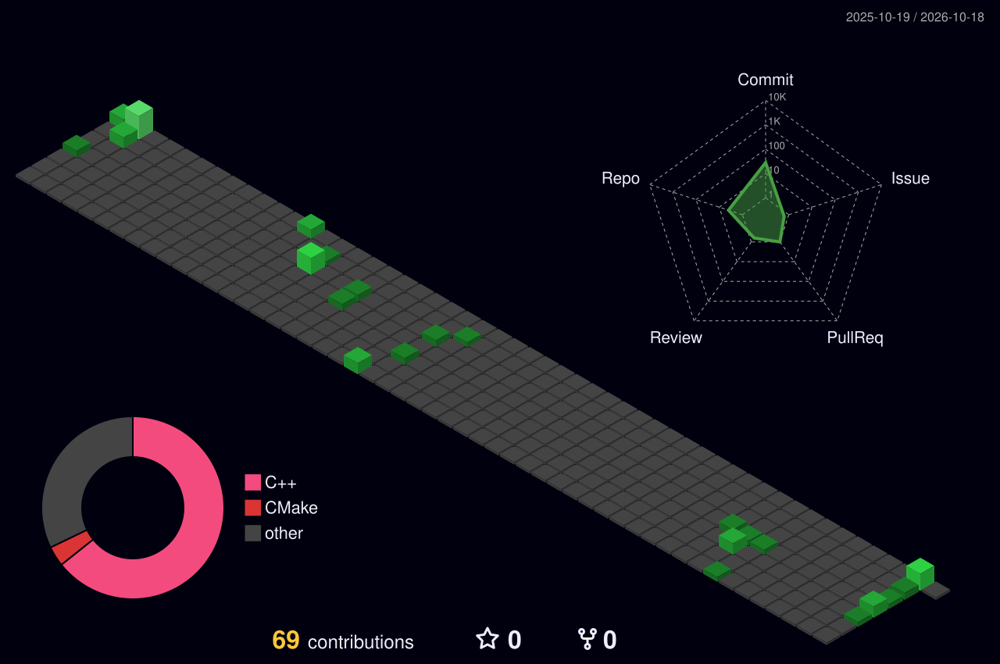

# Hi there! I'm grassfromnorway.

I'm interested in **programming**, **cybersecurity**, **embedded dev**, **electronics**, home labbing and generally most things computer related.  

Technologies I'm comfortable using;

     

My socials if you want to reach out (website isnt here yet..);

---

